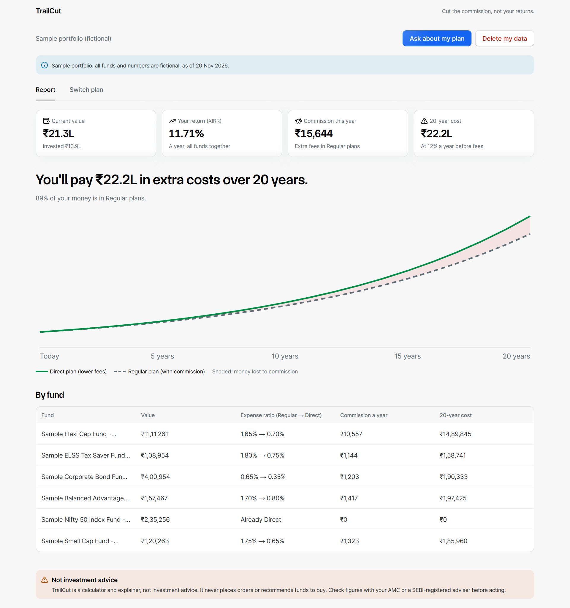
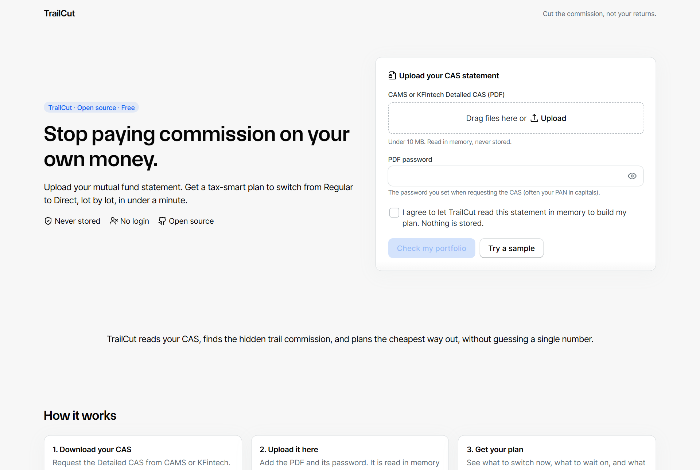
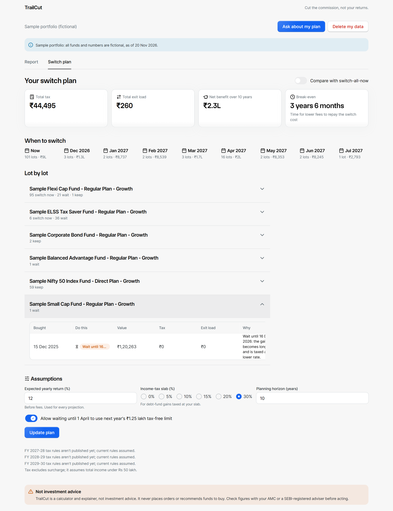
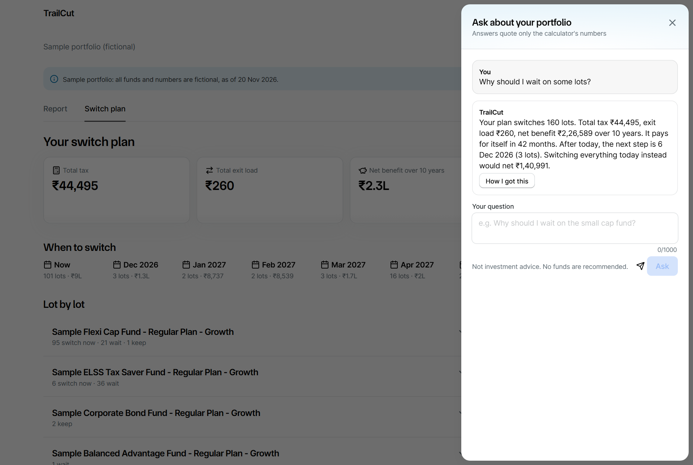
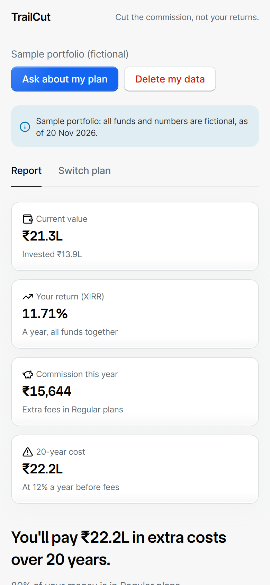
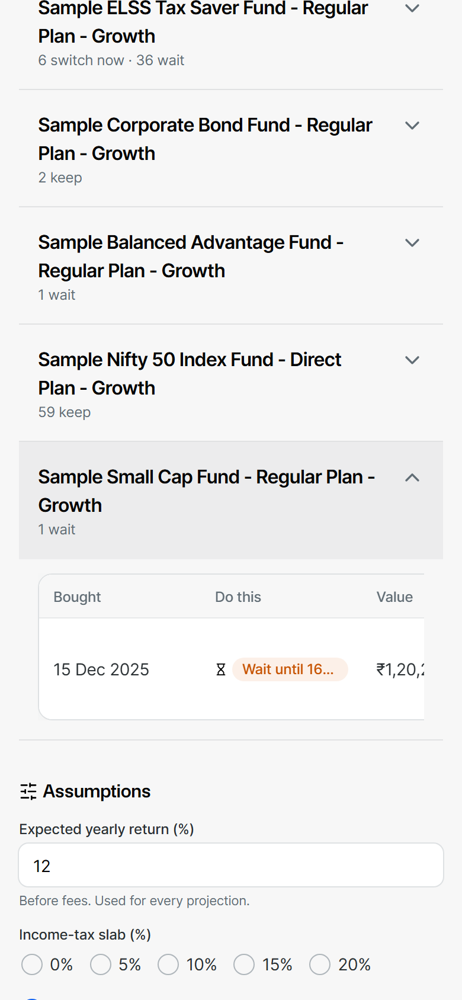
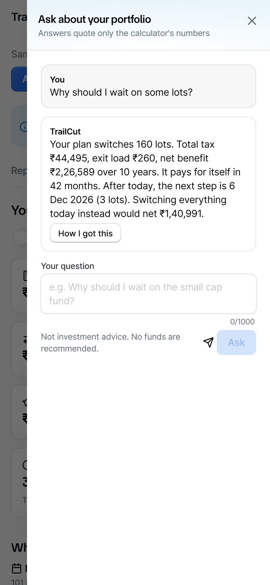

<div align="center">

# TrailCut

**Cut the commission, not your returns.**

[](https://github.com/karthikrshet/trailcut/actions/workflows/ci.yml)




</div>

TrailCut reads your Indian mutual fund statement (CAMS / KFintech CAS), finds the money
you lose to Regular-plan commissions, and plans the cheapest, tax-smart way to move to
Direct plans: which units, in what order, on which date, with the exact tax and exit
load, explained in plain language.

**TrailCut is a calculator and explainer, not investment advice.** It never places
orders and never recommends funds to buy.

## Why now

SEBI made Direct plans the default on AMC digital platforms from 1 Nov 2026, yet most
retail money still sits in Regular plans. "Should I switch?" depends on short- and
long-term capital-gains tax, the yearly LTCG exemption, ELSS lock-ins, exit loads and
2018 grandfathering. TrailCut works that out lot by lot.

## What you get

- **Commission leak**: what Regular plans cost this year and over 10 and 20 years.
- **Lot-by-lot switch plan**: *Switch now*, *Wait until 16 Dec 2026*, or *Keep*, with a
  one-line reason for every purchase lot.
- **Tax and exit load**: STCG, LTCG, the ₹1.25 lakh yearly exemption shared across lots,
  FY split across 31 Mar / 1 Apr, ELSS lock-in, grandfathered cost, debt at your slab.
- **Baselines**: compared with "switch everything today" and "never switch", plus
  break-even.
- **What-if assumptions**: return, tax slab, horizon, exemption use, expense ratios.
- **Ask the AI**: an agent team that explains your plan and only quotes numbers the
  calculator produced.
- **Private by design**: the PDF is read in memory, PII is masked, nothing is stored.

## Screenshots

| Landing | Switch plan | Ask the AI |
| --- | --- | --- |
|  |  |  |

On a phone (375 px):

| Report | Plan | Chat |
| --- | --- | --- |
|  |  |  |

Want to use it? Read the **[user guide](docs/user-guide.md)**.

## Architecture

```
apps/web (React + Vite + Blade) ──HTTPS/JSON──▶ apps/api (FastAPI)
                                                  │
              ┌───────────────────────────────────┼──────────────────────────────┐
              ▼                                   ▼                              ▼
   packages/ingest                      packages/engine                 packages/agent
   casparser → normalize                pure, no I/O, Decimal           Claude tool calling
   → mask PII (no PII fields)           XIRR · FIFO lots · tax          4 specialists, 8 tools
                                        exit load · TER projections     numeric-claim validator
                                        switch optimizer                offline fallback
                                                  ▲
                                        data/tax_rules/*.yaml (rates + sources)
```

| Package | Docs |
| --- | --- |
| User guide | [docs/user-guide.md](docs/user-guide.md) |
| Testing | [docs/testing.md](docs/testing.md) |
| Ingestion | [docs/ingestion.md](docs/ingestion.md) |
| Agents | [docs/agents.md](docs/agents.md) |
| API | [docs/api.md](docs/api.md) |
| Runbooks | [docs/runbooks/](docs/runbooks/README.md) |

## How the optimizer works

For every lot of every Regular fund, the planner prices a switch on a few candidate
dates: today, the day the lot turns long term, the day its exit load ends, the day an
ELSS lock-in ends, and 1 April (a fresh ₹1.25 lakh exemption). For each date it grows
the lot at *return − Regular TER* until the switch, deducts exit load and tax, grows the
rest at *return − Direct TER* to your horizon, and compares that with never switching.
It picks the best date, or keeps the lot if no date wins. Lots with the biggest yearly
saving claim the shared exemption first. The plan is deterministic, never sells locked
ELSS units, and is never worse than switching everything today (property-tested).

Every tax figure comes from `data/tax_rules/fy2026_27.yaml`, each with a legal reference
and source URL. Nothing is hardcoded.

## The AI never does maths

Agents plan and explain; engine tools calculate. A validator extracts every ₹ amount,
percentage, date and count from an answer and rejects it unless each one appears in that
turn's tool output. Figures inside statement text (fund names) never count as evidence.
After one failed repair the user gets the calculator's own figures instead. Fund picking
and order placement are refused before any model call.

## Quality

- `make check`: ruff, mypy `--strict`, ESLint (type-checked + a11y), tsc.
- `make test`: pytest + Hypothesis (engine coverage gate ≥ 90%), FastAPI, Vitest.
- `make e2e`: Playwright on desktop and 375 px.
- `make evals`: agent scenarios ×3 (routing, refusals, injection, figures); offline mode
  runs in CI.
- A pre-commit hook runs check + test on every commit; CI runs the same four stages.

## Run locally

Needs [uv](https://docs.astral.sh/uv/), Node 22 and pnpm.

```bash
make install        # uv sync, pnpm install, enable git hooks
make dev            # API on :8000, web on :5173 (click "Try a sample")
make check && make test
```

Or run the API in Docker:

```bash
docker compose up --build   # API on :8000, non-root, read-only filesystem
```

No `make` (e.g. Windows)? Run `uv run python scripts/dev.py <target>` instead.
Set `ANTHROPIC_API_KEY` for written chat answers; without it chat answers from the
engine's figures. See `apps/api/src/trailcut_api/settings.py` for every setting.

## Privacy

- PDF and password are handled in memory only; the upload buffer is zeroed after parsing.
- The engine's models have no fields for name, PAN, email, phone, address, nominees or
  folio numbers. Remaining text is masked; Hypothesis plants PII to prove none leaks.
- Sessions live in memory for 30 minutes; **Delete my data** removes them immediately.
- No logging in the ingestion package (enforced by a repo policy test).

## Known gaps

- `data/market/ter.csv` ships empty: until it is filled from AMFI's expense-ratio data,
  real statements ask you for each fund's two expense ratios (shown on its factsheet).
  The sample portfolio works fully.
- Tax-rule `source_url`s point at the Income-tax Act index; confirm each section link.
- Surcharge is not modelled (assumes total income under ₹50 lakh).
- MF Central, Summary and NSDL/CDSL statements are detected and rejected, not parsed.

## Roadmap

Fund overlap, PDF report export, reminders when lots turn long term, an MCP server for
the engine, Hindi and Kannada explanations.

## License

MIT. Data: AMFI; statement parsing by [casparser](https://github.com/codereverser/casparser) (MIT).

*Not investment advice. TrailCut is a calculator; check with a SEBI-registered adviser
before acting.*
