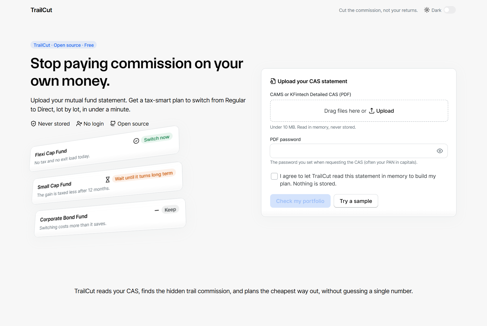
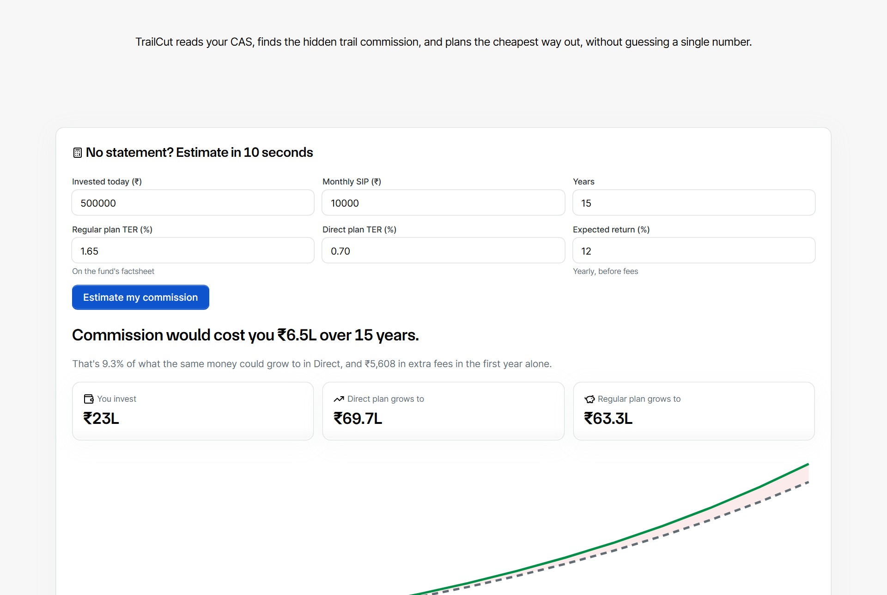
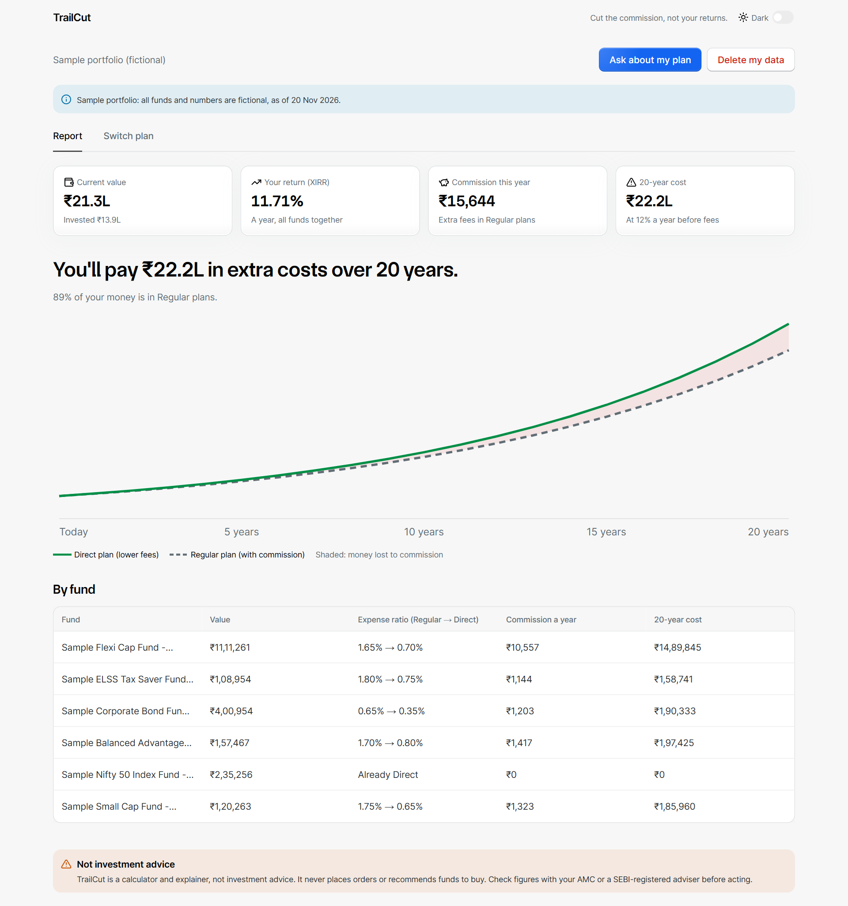
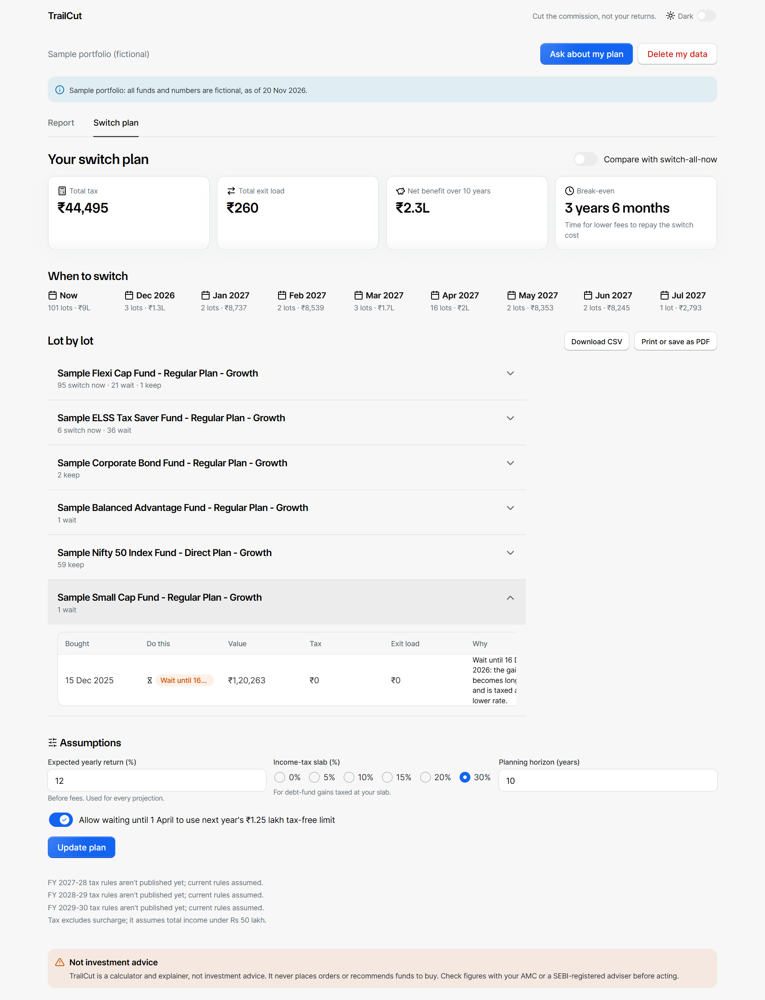
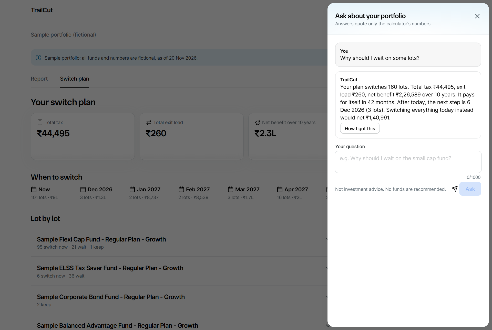

# TrailCut user guide

TrailCut shows what Regular mutual fund plans cost you and plans the cheapest way to
move each purchase to the Direct plan of the **same fund**. It is a calculator and
explainer, not investment advice: it never recommends funds and never places orders.

## Just curious? Estimate first

No statement handy? Under **No statement? Estimate in 10 seconds** on the home page,
enter what you've invested, your monthly SIP, the number of years and the Regular and
Direct expense ratios from a fund's factsheet. You'll see what commission costs over
that time, and how much of it you pay in the first year.

## 1. Get your statement (2 minutes)

You need the **Detailed** Consolidated Account Statement (CAS) from CAMS or KFintech.

1. Go to the CAS request page on camsonline.com (or KFintech's).
2. Choose **Detailed** (with transactions), not Summary.
3. Pick a period **from your first investment** to today. If the period starts later,
   TrailCut can't see when older units were bought and marks them *Review*.
4. Set a password and submit. The PDF arrives by email in a few minutes.

TrailCut can't read MF Central, Summary or NSDL/CDSL statements yet, and tells you if
you upload one.

## 2. Upload it

1. Choose the PDF (under 10 MB) and type the password you set.
2. Tick the consent box. The statement is read in memory and never stored.
3. Press **Check my portfolio**.

Want to look around first? Press **Try a sample** for a fictional six-fund portfolio.

## 3. Read the report

| Card | Meaning |
| --- | --- |
| Current value | What your funds are worth on the statement date, and how much you put in. |
| Your return (XIRR) | Your yearly return across all purchases and redemptions. |
| Commission this year | Extra fees Regular plans charge you this year (value × the difference in expense ratio). |
| 20-year cost | What that difference grows to over 20 years at your expected return. |

The chart shows the same money in Regular (dashed) and Direct (solid) plans; the shaded
gap is the commission. The table lists each fund's expense ratios and its own cost.

## 4. Follow the switch plan

The plan looks at **every purchase lot** separately, because each has its own date,
gain, tax and exit load.

| Badge | What to do |
| --- | --- |
| ✅ **Switch now** | Switching today pays for itself within your horizon. |
| ⏳ **Wait until <date>** | Switching gets cheaper on that date: the gain turns long term, the exit load ends, an ELSS lock-in ends, or a new financial year gives a fresh ₹1.25 lakh tax-free limit. |
| ➖ **Keep** | Switching costs more in tax and exit load than the lower fees earn back over your horizon, or the fund is already Direct. |
| ⚠️ **Review** | We can't size it: the expense ratios are missing (add them, below) or the units pre-date your statement. |

At the top: total tax, exit load, net benefit over your horizon, and the break-even
time. Turn on **Compare with switch-all-now** to see what switching everything today
would cost instead. **When to switch** lists the dates in order.

**To switch a lot**: on your AMC's site or app (or the platform you use), redeem or
switch out those units from the Regular plan and invest the proceeds in the Direct plan
of the same scheme. TrailCut doesn't do this for you.

### Missing expense ratios

If a fund shows *Review* because its expense ratios are missing, enter the **Regular**
and **Direct** TER from the fund's factsheet (for example 1.65 and 0.70) and press
**Use these expense ratios**.

### Download or print the plan

Under **Lot by lot**, **Download CSV** saves every lot with its action, date, tax, exit
load and reason (opens in Excel or Google Sheets). **Print or save as PDF** opens your
browser's print dialog without the buttons.

## 5. Change the assumptions

Every assumption is visible and editable under **Assumptions**:

- **Expected yearly return** (before fees), used for every projection.
- **Income-tax slab**, for debt-fund gains taxed at your slab.
- **Planning horizon** in years.
- **Wait for 1 April**: allow waiting into the next financial year to use its
  tax-free limit.

Press **Update plan**; everything recalculates.

## 6. Ask questions

Press **Ask about my plan** and pick a suggestion or type a question, for example
*"Why should I wait on the small cap fund?"* or *"What if returns are 8%?"*.

- Answers only quote numbers the calculator produced; **How I got this** shows the steps.
- "Should I…" answers carry a not-investment-advice note.
- Questions like "which fund should I buy?" are politely refused.
- Without an AI key configured, answers come straight from the calculator.

## 7. Dark mode

Use the **Dark** switch at the top right. TrailCut follows your device setting until you
choose, and remembers your choice on this device.

## 8. Delete your data

Press **Delete my data** at any time. Otherwise everything is cleared 30 minutes after
your last action. TrailCut never stores your PDF, password, PAN, email, phone or folio
numbers.

## Assumptions and limits

- Tax rules for FY 2026-27 (equity STCG 20%, LTCG 12.5% above ₹1.25 lakh a year after
  12 months; debt bought from 1 Apr 2023 at your slab). Later years assume the same rules.
- Surcharge is not included (assumes total income under ₹50 lakh); 4% cess is.
- Exit loads default to 1% within 365 days for equity and hybrid funds, none for ELSS and
  debt, unless the fund's own schedule is known.
- Hybrid and unknown fund types are taxed like debt, which can only overstate tax.
- Final tax on future withdrawals is ignored on both paths, so switching costs are
  counted in full.
